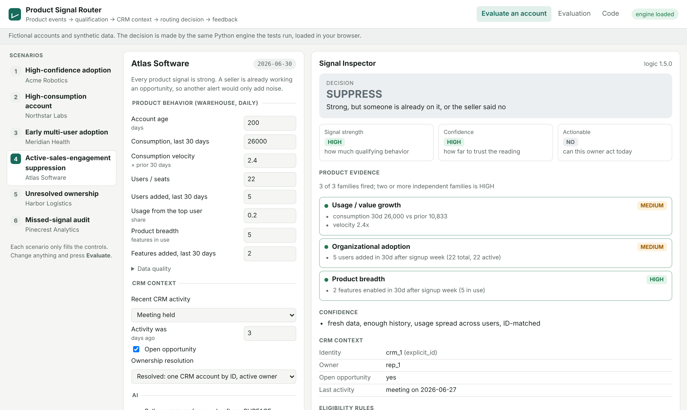

# Product Signal Router

**[Live Demo](https://vrutikadani.github.io/product-signal-router/)** · [Architecture](docs/ARCHITECTURE.md) · [Decision Logic](docs/DECISION_LOGIC.md) · [Evaluation](docs/EVALUATION.md)

Product Signal Router is a reference implementation for evaluating account-level product events and deciding when they warrant GTM action. It is a Python pipeline. It scores each account against deterministic qualification rules, keeps signal strength separate from evidence confidence, and applies suppression, cooldowns and seller capacity so owners don't get duplicate or low-value alerts. The result is a ranked, auditable action routed to the CRM owner, with seller feedback and a replay harness that audits missed signals.

Adversarial replay and independent review exposed failures in suppression, ownership, episode state, account identity and the evaluator itself. The [postmortem](docs/FAILURE_POSTMORTEM.md) documents what broke and how the fixes changed the design.



## How it works

| Stage | What happens |
|---|---|
| **Input** | Account-level product events from the warehouse (consumption, users and seats, features enabled), rolled up to one row per account per day. CRM context for the same account: identity match, owner, owner status, open opportunity, last activity |
| **Decision** | Deterministic rules score three signal families into a **strength** band. A separate **confidence** band records how far to trust the evidence. **Actionability** rules check identity, ownership, existing sales engagement, data freshness and the account's signal history |
| **Output** | One decision per account per day: **SURFACE** (send to the owner, ranked), **HOLD** (stale data, cooldown, open episode, capacity), **SUPPRESS** (already engaged, merged, dismissed), **ROUTE** (identity or ownership unresolved) or **NO_SIGNAL**. Every decision carries the rules it passed and the reason it stopped |
| **Feedback** | Seller dispositions (worked, snoozed, dismissed with a reason) are stored with the signal and read on the next evaluation. A replay harness measures precision, recall and lead time, explains every missed conversion, and runs a coverage audit for large accounts no signal can see |

## Why this is harder than a join

Joining product data to CRM records is easy. Deciding what deserves a seller's time is not:

- **Usage isn't intent.** One power user, one large transaction or a team's onboarding month can all look like growth.
- **A strong signal can still be the wrong thing to send.** A seller may already be in the account, the owner may have left, or the seller may have said "not a fit" two weeks ago.
- **Seller attention is the scarce resource.** An alert feed that sellers learn to ignore is worse than no feed.
- **Misses are invisible** unless you go looking for them.

## Design principles

1. **Behavior is evidence, not intent.** Signals describe what changed. Every one carries the evidence behind it.
2. **Signal strength is not actionability.** Strength, confidence and actionability are computed separately. A HIGH-strength, HIGH-confidence account with an open opportunity is suppressed, not ranked first.
3. **Deterministic rules decide; AI only summarizes.** The model runs after the decision, sees only aggregates, and can fail without changing anything.
4. **Seller attention is scarce.** One open signal per account episode (an unanswered signal stays quiet rather than being repeatedly re-sent), one per CRM account, a weekly cap per owner, and reasons for everything held back.
5. **Measure the misses.** Recall and a false-negative audit sit next to precision, plus a coverage audit for accounts that signals structurally can't see.
6. **Feedback changes the system.** Dismissals are read on the next evaluation, with reason-specific effects.

## Pipeline

```
product events ─► daily features ─► strength (3 families) + confidence
                                            │
CRM context ──────────────────────► actionability rules ─► one per CRM account ─► owner capacity
                                            │                                          │
signal store (feedback, episodes) ──────────┘                    SURFACE ─► optional AI note ─► owner
                                                                 ROUTE   ─► ownership queue
                                                                 HOLD / SUPPRESS ─► recorded with reason
```

| Product behavior | Signal family | What it indicates |
|---|---|---|
| Spend, transactions, consumption | Usage / value | Growth in consumption or value |
| Additional users, seats, departments | Organizational adoption | More of the organization is using it |
| Additional modules, features, workflows, integrations | Product breadth | Operational embedding |

The mechanisms that keep this reliable:

- **Account-day deduplication.** A signal's key is the account and the day its features describe, so replaying a day or re-running it under new logic never opens a second signal.
- **Episodes, not daily alerts.** An open signal is held while it waits on the seller. After it expires unanswered, the account stays quiet unless strength rises.
- **Identity resolution.** Several product accounts can map to one CRM account. Only one signal per CRM account goes out per day, with a deterministic winner.
- **Ownership checks.** No owner, an inactive owner or more than one CRM match routes the signal to a queue instead of guessing.
- **Engagement suppression.** An open opportunity or a recent two-way conversation suppresses. A one-way sequence email does not; it becomes a note for the seller.
- **Missing-data handling.** If the day's warehouse partition is missing, the account is held, not decided on a partial window. Duplicate warehouse rows are dropped on event ID.
- **Seller capacity.** Each owner gets at most N new signals per rolling week. The overflow is held and ranked, with the reason recorded.

Full rules and thresholds: [DECISION_LOGIC.md](docs/DECISION_LOGIC.md). Components, data contract and operating controls: [ARCHITECTURE.md](docs/ARCHITECTURE.md).

## The demo

Six fictional accounts, each a scenario. Every input is editable, and **Evaluate** runs the same Python engine the tests use, loaded in the browser.

| Scenario | Account | Outcome | What it shows |
|---|---|---|---|
| High-confidence adoption | Acme Robotics | SURFACE · HIGH / HIGH | Spend, people and products moving together |
| High-consumption account | Northstar Labs | SURFACE · MEDIUM / MEDIUM | Strong usage from one person: value, not yet an organization |
| Early multi-user adoption | Meridian Health | SURFACE · MEDIUM / MEDIUM | Too new for velocity; seven people joined after signup week |
| Active-sales-engagement suppression | Atlas Software | SUPPRESS · HIGH / HIGH | Strongest signal in the set, and the wrong one to send |
| Unresolved ownership | Harbor Logistics | ROUTE | The owner left; nobody can act until routing is fixed |
| Missed-signal audit | Pinecrest Analytics | NO_SIGNAL, coverage-flagged | One of the largest accounts, flat, invisible to signals |

The **Signal Inspector** shows the product evidence, CRM context, every eligibility rule passed or failed, what the AI was given and whether it ran, the decision, and the signal's feedback history. Dismiss a signal, move the clock forward 20 days, and it stays suppressed; move it 95 days and it can surface again.

## Replay harness: synthetic validation, not a performance benchmark

A daily replay of 400 synthetic accounts over 11 weeks, with simulated seller responses and two late warehouse days. A conversion is the target outcome the replay measures against (in a real deployment, an opportunity or upgrade agreed with Sales).

**These metrics validate the evaluation pipeline and expose failure modes. They are not claims about real-world signal performance.**

| Precision (60d) | Recall (60d) | Signals delivered | Median lead time |
|---|---|---|---|
| 0.20 per signal, 0.24 per account | 0.34 of 38 | 106 | 16 days |

About one in five signals is followed by a conversion within 60 days, and the system finds about a third of the conversions Sales wasn't already working. The outcomes come from archetypes I wrote, and the simulated sellers don't know the outcomes, so these numbers show that the measurement works, not that the signals predict anything in a real business. What the replay did do was find bugs that unit tests missed. [EVALUATION.md](docs/EVALUATION.md) has the method, the per-version results and the miss causes.

## Design decisions that changed as I built it

Each one came from a failing test or a replay result. The [postmortem](docs/FAILURE_POSTMORTEM.md) has the evidence; the commit history shows the order.

- **"Recent CRM activity suppresses" became "recent *two-way* conversation suppresses".** A sequence email nobody answered was blocking signals as "already engaged".
- **"Has an owner" became "has an active owner".** The inactive-owner field was in the v1 model and never checked.
- **Confidence stopped being used as a control.** v1 lowered confidence for short history, and MEDIUM confidence still surfaces, so 17 signals went to large, flat accounts during their onboarding ramp. Anything that must stop a signal is now a rule.
- **Engine memory reads only earlier days**, because replaying a day changed its own answer. That exposed a second bug: the signal key included the logic version, so a re-run under new logic could now duplicate. The key became account-day.
- **The unit of decision moved from product account to CRM account.** Two workspaces for one company sent two signals to one seller.
- **A signal became an episode, not a daily alert.** An unanswered signal was being re-sent every cooldown period. My first fix only stretched that period from 14 to 21 days, which a reviewer caught. Silence now counts as a soft "no".
- **Volume control moved from the strength rule to seller capacity.** Requiring two families looked careful, but in the replay it cut recall from 0.42 to 0.16 with no precision gain.
- **Signup-week setup stopped counting as adoption.**
- **"Up to a day late is fine" became "any missing partition holds".** The first late day was being decided on a partial window.
- **The evaluation's simulated sellers stopped seeing the future.** They had only ever dismissed accounts that weren't going to convert, which made dismissals look free.

## Run it

```bash
pip install -r requirements-dev.txt   # pytest only; the engine is standard library
make test                             # 40 tests, including the adversarial cases
make eval                             # regenerate evals/REPORT.md
make demo                             # serve the demo on http://localhost:8000/web/
```

```
product_signal_router/   engine (features, signals, actionability, pipeline, state, adapters, ai_context, evaluation)
tests/                   unit, adversarial and pipeline tests
evals/                   replay script and the committed report
web/                     static demo (Pyodide)
docs/                    architecture, decision logic, evaluation, postmortem, evidence
```

CI runs the tests on Python 3.11 to 3.13, fails if the committed evaluation report or demo manifest is stale, and checks that the engine imports only the standard library.

## Where this pattern applies

Any business where customers adopt the product before they talk to Sales: PLG SaaS, fintech, developer tools, infrastructure, usage-based products, collaboration software, and marketplaces with business accounts. The objects change and the pattern doesn't: **product events → account context → actionability → routed action → feedback.**

## Not included

There is no real warehouse or CRM connector, no review-queue UI, no shadow mode, kill switch or circuit breaker (these are designed in [ARCHITECTURE.md](docs/ARCHITECTURE.md), not built), and no fitted thresholds.

<sub>Generalized reference implementation built on synthetic data. No employer source code, production customer data or confidential company logic.</sub>
