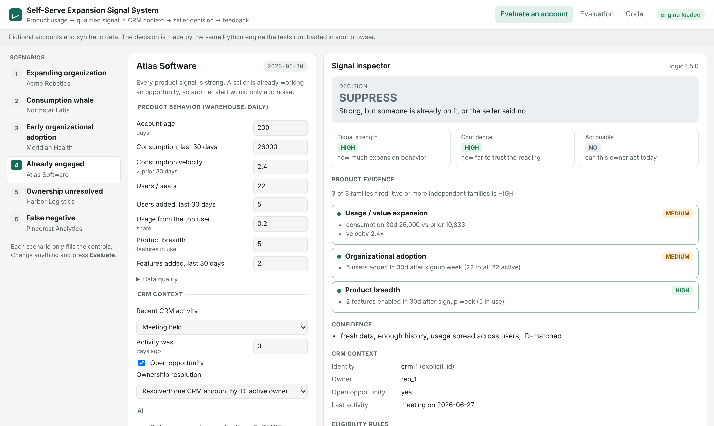

# Self-Serve Expansion Signal System

> Product usage → qualified GTM signal → CRM context → seller action → feedback and measurement.

**[Live Demo](https://vrutikadani.github.io/self-serve-expansion-signals/)** · [Architecture](docs/ARCHITECTURE.md) · [Decision Logic](docs/DECISION_LOGIC.md) · [Evaluation](docs/EVALUATION.md)

A reference implementation for turning product-usage patterns into explainable, measurable sales actions.

**What's here:** a deterministic Python engine that separates *how strong* a usage signal is, *how far to trust it* and *whether a seller can act on it*. Around it: seller feedback that changes later decisions, a replay that measures precision and recall, and an audit of the accounts it misses. Testing against the ways the system breaks found 14 problems in the engine and 2 in its own evaluation, across three rounds. They're written up in the [postmortem](docs/FAILURE_POSTMORTEM.md).



## Why this exists

Self-serve accounts sign up, adopt and grow without talking to anyone. Some of them would buy more, sooner, with a seller's help. The behavior that hints at it (more spend, more people, more of the product) sits in the product warehouse. The people who could act on it work in the CRM.

Joining the two is easy. The hard parts:

- **Usage isn't intent.** One power user, one large transaction or a team's onboarding month can all look like expansion.
- **A strong signal can still be the wrong thing to send.** A seller may already be in the account, the owner may have left, or the seller may have said "not a fit" two weeks ago.
- **Seller attention is the scarce resource.** An alert feed that sellers learn to ignore is worse than no feed.
- **Misses are invisible** unless you go looking for them.

This repo is a small, deterministic system for that problem, tested against the ways it breaks.

## Design principles

1. **Behavior is evidence, not intent.** Signals describe what changed. Every one carries the evidence behind it.
2. **Signal strength is not actionability.** Strength, confidence and actionability are computed separately. A HIGH-strength, HIGH-confidence account with an open opportunity is suppressed, not ranked first.
3. **Deterministic rules decide; AI only summarizes.** The model runs after the decision, sees only aggregates, and can fail without changing anything.
4. **Seller attention is scarce.** One open signal per account episode (unanswered means quiet, not resent), one per CRM account, a weekly cap per owner, and reasons for everything held back.
5. **Measure the misses.** Recall and a false-negative audit sit next to precision, plus a coverage audit for accounts that signals structurally can't see.
6. **Feedback changes the system.** Dismissals are read on the next evaluation, with reason-specific effects.

## What it does

```
product events ─► daily features ─► strength (3 families) + confidence
                                            │
CRM context ──────────────────────► actionability rules ─► one per CRM account ─► seller capacity
                                            │                                          │
signal store (feedback, episodes) ──────────┘                    SURFACE ─► optional AI note ─► seller
                                                                 ROUTE   ─► ownership queue
                                                                 HOLD / SUPPRESS ─► recorded with reason
```

| Product behavior | Signal family | What it suggests |
|---|---|---|
| Spend growth, transactions, consumption | Usage / value | Consumption or value expansion |
| Additional users, seats, departments | Organizational adoption | More of the organization is in |
| Additional cards, features, workflows, integrations | Product breadth | Operational embedding |

Decisions: **SURFACE** (send to the owner), **HOLD** (strong but not today: stale data, cooldown, snooze, open episode, capacity), **SUPPRESS** (already engaged, merged, or dismissed), **ROUTE** (identity or ownership unresolved), **NO_SIGNAL**. Full rules: [DECISION_LOGIC.md](docs/DECISION_LOGIC.md).

## The demo

Six fictional accounts, each a scenario. Every input is editable, and **Evaluate** runs the same Python engine the tests use, loaded in the browser.

| Scenario | Account | Outcome | What it shows |
|---|---|---|---|
| Expanding organization | Acme Robotics | SURFACE · HIGH / HIGH | Spend, people and products moving together |
| Consumption whale | Northstar Labs | SURFACE · MEDIUM / MEDIUM | Strong usage from one person: value, not yet an organization |
| Early organizational adoption | Meridian Health | SURFACE · MEDIUM / MEDIUM | Too new for velocity; seven people joined after signup week |
| Already engaged | Atlas Software | SUPPRESS · HIGH / HIGH | Strongest signal in the set, and the wrong one to send |
| Ownership unresolved | Harbor Logistics | ROUTE | The owner left; nobody can act until routing is fixed |
| False negative | Pinecrest Analytics | NO_SIGNAL, coverage-flagged | One of the largest accounts, flat, invisible to signals |

The **Signal Inspector** shows the product evidence, CRM context, every eligibility rule passed or failed, what the AI was given and whether it ran, the decision, and the signal's feedback history. Dismiss a signal, move the clock forward 20 days, and it stays suppressed; move it 95 days and it can surface again.

## Evaluation (synthetic)

A daily replay of 400 synthetic accounts over 11 weeks, with simulated seller responses and two late warehouse days:

| Precision (60d) | Recall (60d) | Signals delivered | Median lead time |
|---|---|---|---|
| 0.20 per signal, 0.24 per account | 0.34 of 38 | 106 | 16 days |

About one in five signals is followed by an expansion within 60 days, and the system finds about a third of the expansions Sales wasn't already working. The outcomes come from archetypes I wrote, and the simulated sellers don't know the outcomes, so these numbers show that the measurement works, not that the signals predict anything in a real business. What the replay did do was find bugs that unit tests missed. [EVALUATION.md](docs/EVALUATION.md) has the method, the per-version results and the miss causes.

## Design decisions that changed as I built it

Each one came from a failing test or a replay result. The [postmortem](docs/FAILURE_POSTMORTEM.md) has the evidence; the commit history shows the order.

- **"Recent CRM activity suppresses" became "recent *two-way* conversation suppresses".** A sequence email nobody answered was blocking signals as "already engaged".
- **"Has an owner" became "has an active owner".** The inactive-owner field was in the v1 model and never checked.
- **Confidence stopped being used as a control.** v1 lowered confidence for short history, and MEDIUM confidence still surfaces, so 17 signals went to large, flat accounts during their onboarding ramp. Anything that must stop a signal is now a rule.
- **Engine memory reads only earlier days**, because replaying a day changed its own answer. That exposed a second bug: the signal key included the logic version, so a re-run under new logic could now duplicate. The key became account-day.
- **The unit of decision moved from product account to CRM account.** Two workspaces for one company sent two signals to one seller.
- **A signal became an episode, not a daily alert.** An unanswered signal was being resent every cooldown period. My first fix only stretched that period from 14 to 21 days, which a reviewer caught. Silence now counts as a soft "no".
- **Volume control moved from the strength rule to seller capacity.** Requiring two families looked careful, but in the replay it cut recall from 0.42 to 0.16 with no precision gain.
- **Signup-week setup stopped counting as adoption.**
- **"Up to a day late is fine" became "any missing partition holds".** The first late day was being decided on a partial window.
- **The evaluation's simulated sellers stopped seeing the future.** They had only ever dismissed accounts that weren't going to expand, which made dismissals look free.

## Run it

```bash
pip install -r requirements-dev.txt   # pytest only; the engine is standard library
make test                             # 40 tests, including the adversarial cases
make eval                             # regenerate evals/REPORT.md
make demo                             # serve the demo on http://localhost:8000/web/
```

```
expansion_signals/   engine (features, signals, actionability, pipeline, state, adapters, ai_context, evaluation)
tests/               unit, adversarial and pipeline tests
evals/               replay script and the committed report
web/                 static demo (Pyodide)
docs/                architecture, decision logic, evaluation, postmortem, evidence
```

## Where this pattern applies

Any business where customers adopt before they talk to Sales: PLG SaaS, fintech, developer tools, infrastructure, usage-based products, collaboration software, and marketplaces with business accounts. The objects change and the pattern doesn't: **first-party behavior → account context → actionability → seller action → feedback.**

## Not included

There is no real warehouse or CRM connector, no review-queue UI, no shadow mode, kill switch or circuit breaker (these are designed in [ARCHITECTURE.md](docs/ARCHITECTURE.md), not built), and no fitted thresholds. All accounts and data are fictional.

<sub>Synthetic reference implementation. No employer code, customer data or proprietary logic.</sub>
