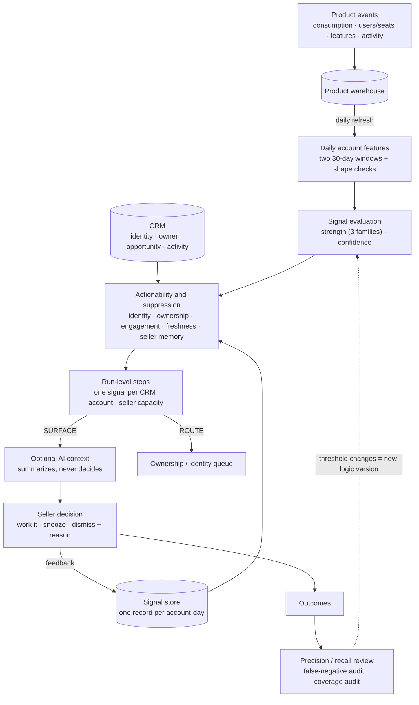

# Architecture

## Components

| Module | Responsibility | Production equivalent |
|---|---|---|
| [`features.py`](../expansion_signals/features.py) | Events → one row per account per day | A SQL model in the warehouse |
| [`signals.py`](../expansion_signals/signals.py) | Strength families and confidence | Same logic, in SQL or a scheduled job |
| [`actionability.py`](../expansion_signals/actionability.py) | Rules that block a strong signal | Same job, reading a CRM snapshot |
| [`engine.py`](../expansion_signals/engine.py) | One account, one day → `Evaluation` | Same job |
| [`pipeline.py`](../expansion_signals/pipeline.py) | The daily batch, CRM-account merge, capacity | Orchestrator task after the warehouse refresh |
| [`state.py`](../expansion_signals/state.py) | Signal records, lifecycle, feedback | A table, or a custom CRM object with history |
| [`adapters.py`](../expansion_signals/adapters.py) | `WarehouseSource`, `CrmSource`, `SellerSink` protocols, plus in-memory versions | Warehouse client, CRM API client, task/queue writer |
| [`ai_context.py`](../expansion_signals/ai_context.py) | Optional post-decision summary | A model call behind a feature flag |
| [`evaluation.py`](../expansion_signals/evaluation.py) | Replay, metrics, false-negative and coverage audits | A weekly notebook or dashboard |

The engine uses only the Python standard library. That's why the demo can load the same files in the browser through Pyodide. CI enforces it.

## Why a daily batch

The warehouse refreshes daily, so a signal can't know more than once a day. Streaming would add a queue, consumer state and replay semantics, and the inputs underneath would still change once a day. A batch also makes replay simple: re-running a day is the same function on the same inputs.

If the source ever became intraday, the engine wouldn't change. `run_daily` would run more often, and the account-day key would become account-window.

## Idempotency and replay

- A signal's key is `account_id:as_of`: the day the features describe, not when the job ran, and not the logic version.
- Engine memory (cooldown, snooze, dismissal, open episode) reads only records from *earlier* days. A same-day record is the result of this evaluation, not an input to it.
- Run-level steps (CRM-account merge, capacity) give existing same-day records their slot first, so a replay chooses the same winners.
- Delivery happens only when a record is created. Replaying a day delivers nothing new and returns the same decisions (`test_replay_is_idempotent`, `test_replay_keeps_capacity_slots`).

## Data contract (warehouse → engine)

| Field | Meaning | Notes |
|---|---|---|
| `account_id` | Product account (workspace, org, tenant) | Not the CRM ID; identity resolution maps it |
| `as_of` | The day the features describe | |
| `data_loaded_through` | Latest complete partition | More than 1 day behind → HOLD, never decide on a partial window |
| `account_age_days` | Days since the product account was created | Value family needs ≥ 60 |
| `consumption_30d`, `consumption_prior_30d` | Value in the product's unit, two windows | |
| `largest_event_share_30d` | Biggest single event / 30-day total | Spike check |
| `top_user_share_30d` | Biggest single user's share of 30-day consumption | Concentration check |
| `users_total`, `users_added_30d`, `active_users_30d` | Seats | Additions exclude the first 7 days of the account |
| `features_total`, `features_added_30d` | Breadth | Same signup-week exclusion |

## CRM contract (CRM → engine, read-only)

`crm_account_ids` (identity resolution result: zero, one or several), `match_method` (`explicit_id` / `domain` / `none`), `owner_id`, `owner_active`, `open_opportunity`, `last_activity_date`, `last_activity_type`.

The engine never writes ownership. When it can't find one active owner on one CRM account, it routes the signal to a queue and counts the gap, instead of guessing.

## Operating controls (designed, not built here)

These belong to a real deployment and aren't implemented in this repository:

- **Shadow mode.** Run for 2 to 4 weeks writing records but delivering nothing; compare against what sellers did anyway.
- **Kill switch.** One flag that stops delivery and keeps evaluation and history running.
- **Silent-expiry circuit breaker.** If most delivered signals expire with no response for two weeks in a row, pause delivery whatever the cause. That measures "is the workflow working at all", which is a separate question from "are the signals good".
- **Logic versioning.** Every record carries the logic version that produced it, so evaluation can compare versions on the same history.
