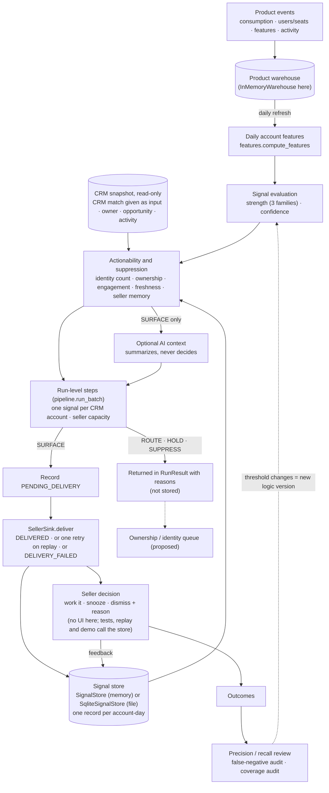

# Architecture

Seller status on a record: OPEN, then ACTIONED, SNOOZED, DISMISSED or CLEARED. Expiry is not a stored state: the rules treat an OPEN record older than 21 days as expired. The `EXPIRED` constant exists in `state.py`, and nothing assigns it.

## Components

| Module | Responsibility | Production equivalent |
|---|---|---|
| [`features.py`](../product_signal_router/features.py) | Events → one row per account per day | A SQL model in the warehouse |
| [`signals.py`](../product_signal_router/signals.py) | Strength families and confidence | Same logic, in SQL or a scheduled job |
| [`actionability.py`](../product_signal_router/actionability.py) | Rules that block a strong signal | Same job, reading a CRM snapshot |
| [`engine.py`](../product_signal_router/engine.py) | One account, one day → `Evaluation` | Same job |
| [`pipeline.py`](../product_signal_router/pipeline.py) | `run_daily` (features + `run_batch`); `run_batch`: engine, CRM-account merge, capacity, record and deliver | Orchestrator task after the warehouse refresh |
| [`state.py`](../product_signal_router/state.py) | Signal records, delivery state, lifecycle, feedback; in-memory store | A table, or a custom CRM object with history |
| [`sqlite_store.py`](../product_signal_router/sqlite_store.py) | The same store in a SQLite file, so memory survives a restart | A warehouse or Postgres table |
| [`adapters.py`](../product_signal_router/adapters.py) | `WarehouseSource`, `CrmSource`, `SellerSink` protocols, `PermanentDeliveryError`, plus in-memory versions | Warehouse client, CRM API client, task writer |
| [`ai_context.py`](../product_signal_router/ai_context.py) | Optional post-decision summary | A model call behind a feature flag |
| [`evaluation.py`](../product_signal_router/evaluation.py) | Replay, metrics, false-negative and coverage audits | A weekly notebook or dashboard |

The engine uses only the Python standard library. That's why the demo can load the same files in the browser through Pyodide. CI enforces it. `sqlite_store.py` also uses only the standard library, but the demo doesn't load it.

## Why a daily batch

The warehouse refreshes daily, so a signal can't know more than once a day. Streaming would add a queue, consumer state and replay semantics, and the inputs underneath would still change once a day. A batch also makes replay simple: re-running a day is the same function on the same inputs.

If the source ever became intraday, the engine wouldn't change. `run_daily` would run more often, and the account-day key would become account-window.

## Idempotency and replay

- A signal's key is `account_id:as_of`: the day the features describe, not when the job ran, and not the logic version.
- Engine memory (cooldown, snooze, dismissal, open episode) reads the latest *delivered* record on any day except the one being evaluated. A same-day record is the result of this evaluation, not an input to it. Later days count, so a backfill sees a later dismissal (`test_backfill_after_dismissal_does_not_redeliver`).
- Run-level steps (CRM-account merge, capacity) give existing same-day records their slot first, so a replay chooses the same winners. A record whose delivery gave up takes no capacity slot, so it does not hold the next account behind it (`test_undeliverable_signal_does_not_hold_capacity_on_replay`). Each step adds a line to the evaluation's trace.
- Delivery is an outbox. The record is written as `PENDING_DELIVERY`, the sink is called with the signal key as its idempotency key, and only a returned call marks it `DELIVERED`. A sink error is recorded on that record and the batch continues (`test_sink_failure_does_not_abort_batch`). Replaying the same day retries it once (`test_transient_failure_is_retried_once_on_replay`, `test_persistent_failure_is_retried_exactly_once`). `PermanentDeliveryError` is not retried.
- A day older than the latest processed day, or outside the freshness window, is a backfill: decisions are recorded, nothing is sent, including a record left pending by an earlier failed run of that day (`test_backfill_records_but_never_delivers`, `test_replaying_a_pending_day_after_a_newer_day_does_not_send`).
- Replaying a delivered day delivers nothing new and returns the same decisions (`test_replay_is_idempotent`, `test_replay_keeps_capacity_slots`), also after a restart on the SQLite store (`test_sqlite_store_keeps_memory_across_restart`).
- At-least-once, not exactly-once: if the sink succeeds and the process dies before `DELIVERED` is written, the replay sends again with the same key. The sink's idempotency key is what makes that safe.

## Data contract (warehouse → engine)

| Field | Meaning | Notes |
|---|---|---|
| `account_id` | Product account (workspace, org, tenant) | Not the CRM ID; an upstream identity match (not in this repo) maps it |
| `as_of` | The day the features describe | |
| `data_loaded_through` | Latest complete partition | Earlier than `as_of` → HOLD, never decide on a partial window |
| `account_age_days` | Days since the product account was created | Value family needs ≥ 60 |
| `consumption_30d`, `consumption_prior_30d` | Value in the product's own unit (currency, credits, API calls), two windows. The 4,000 floor in config is in that unit | Rows are deduplicated on `event_id`, because a replayed partition would otherwise double a month |
| `largest_event_share_30d` | Biggest single event / 30-day total | Spike check |
| `top_user_share_30d` | Biggest single user's share of 30-day consumption | Concentration check |
| `users_total`, `users_added_30d`, `active_users_30d` | Seats | Additions exclude the first 7 days of the account |
| `features_total`, `features_added_30d` | Breadth | Same signup-week exclusion |

## CRM contract (CRM → engine, read-only)

`crm_account_ids` (the result of an upstream identity match, not done here: zero, one or several), `match_method` (`explicit_id` / `domain` / `none`), `owner_id`, `owner_active`, `open_opportunity`, `last_activity_date`, `last_activity_type`.

The engine never writes ownership. When it can't find one active owner on one CRM account, it returns ROUTE with the reason instead of guessing. The queue that would collect those is proposed, not built.

## Operating controls (designed, not built here)

These belong to a real deployment and aren't implemented in this repository:

- **Shadow mode.** Run for 2 to 4 weeks writing records but delivering nothing; compare against what sellers did anyway.
- **Kill switch.** One flag that stops delivery and keeps evaluation and history running.
- **Silent-expiry circuit breaker.** If most delivered signals expire with no response for two weeks in a row, pause delivery whatever the cause. That measures "is the workflow working at all", which is a separate question from "are the signals good".
- **Logic versioning.** Every record carries the logic version that produced it, so evaluation can compare versions on the same history.
